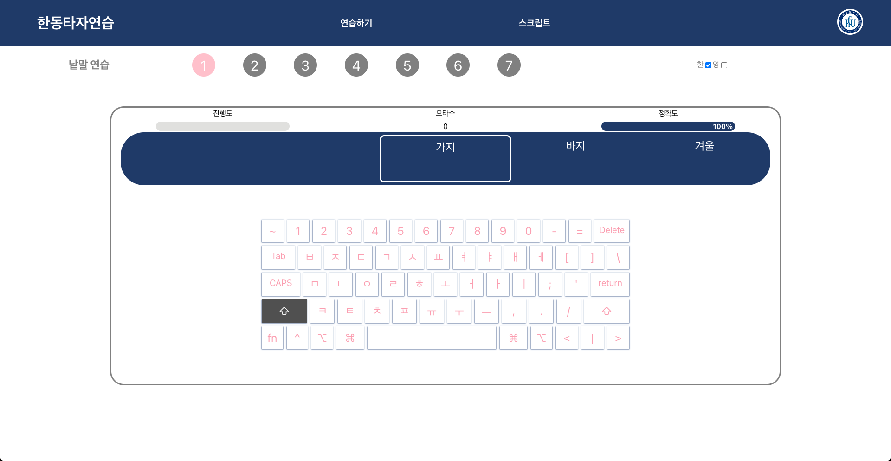

# 오픈소스 스튜디오 01분반

22300650 / 전도원

## Assignment 10. React Open Source Project Customizing & Deployment

## Deployment

GitHub URL: https://github.com/2026-2-OSS/assign10-c01-22300650

Vercel URL: https://soongcom-react.vercel.app/

## Project Information

프로젝트: 숭컴 타자연습 (soongcom-react)

원본 GitHub URL: https://github.com/SoongComTyping/soongcom-react

License: MIT License (Copyright (c) 2021 SoongComTyping).

- 원본 LICENSE 파일을 그대로 유지했습니다.

숭실대학교 컴퓨터학부 학생들이 만든 React 타자연습 웹입니다. 자리연습, 단어연습, 문장연습, 스크립트 연습을 할 수 있습니다.

### 선택 이유

1. 어릴적 초등학교 컴퓨터 시간에 정말 많이 했던 한컴타자연습과 비슷한 오픈소스를 발견해서 추억이 새록새록 떠올라 해당 프로젝트를 선택했습니다. React로 구현되어 있어 조건에 맞았고, 어렸을 때 타자연습을 할 때에는 컴퓨터공학을 전공할 거란 것을 상상도 못했었는데, 컴공생이 된 지금은 타자연습을 위해 사이트에 들어가는게 아니라 코드를 뜯어보려고 들어간다는 사실이 저를 흥분하게 만들었습니다.
2. 원본은 숭실대학교용으로 만들어져 있어서, 한동대학교 버전으로 수정하기에 좋다고 생각했습니다.

## Installation

- git clone https://github.com/2026-2-OSS/assign10-c01-22300650.git
- cd assign10-c01-22300650
- npm install
- npm run start

localhost:3000 에서 실행됩니다.

### 실행 화면




### 실행 전 수정한 부분

원본 프로젝트는 그대로는 실행되지 않아서 아래 내용을 AI를 사용하여 파악하고 수정했습니다.

1. 사용하지 않는 node-sass가 Node 22에서 설치에 실패해서 제거하고 react-scripts를 4.0.3에서 5.0.1로 올렸습니다.
2. 앱이 front/ 폴더 안에 있어서 Vercel 배포를 위해 저장소 루트로 옮겼습니다.
3. 원본 웹은 연습 데이터를 외부 서버에서 fetch로 받아오는데, 서버가 종료되어 데이터가 더이상 불러와지지 않았습니다. 따라서 src/data/practiceData.js 파일을 따로 만들어 연습 데이터를 로컬 배열로 옮기고 이 데이터를 사용하도록 했습니다.

## Source Code Exploration

### Project Structure

1. **src/App.js**: 주소마다 어떤 페이지를 보여줄지 정하는 파일입니다. Route로 /practice-key는 자리연습, /practice-word는 단어연습 이런 식으로 연결되어 있습니다.
2. **src/data/practiceData.js**: 서버가 꺼져 있어서 제가 새로 만든 파일입니다. 연습용 단어랑 글자가 배열로 들어 있고, 배열 index가 단계를 뜻합니다.
3. **src/app/store.js**: Redux store를 만드는 파일입니다. 틀린 글자 수나 진행도처럼 여러 컴포넌트가 같이 쓰는 값을 여기 모아서 관리합니다.

### React Component

1. **Header (src/components/Header.js)**: 모든 페이지 위에 나오는 헤더입니다. 메뉴에 마우스를 올리면 useState 값(isHovering, isChoosing)이 바뀌고, 둘 중 하나라도 true면 세부 메뉴(DetailMenu)가 보입니다. isChoosing이 따로 있는 건 세부 메뉴로 마우스를 내려도 메뉴가 안 사라지게 하려고 그런 것 같습니다.
2. **Sentence (src/features/practices/sentences/Sentence.js)**: 문장연습에서 문장을 한 글자씩 span으로 나눠서 보여주는 컴포넌트입니다. 내가 친 글자랑 비교해서 맞으면 done, 틀리면 different className을 붙여서 색이 다르게 보입니다.

### Code Analysis

src/components/DetailMenu.js

```js
const PracticeModes = [
  { title: "자리연습", href: "/practice-key" },
  { title: "단어연습", href: "/practice-word" },
  { title: "문장연습", href: "/practice-sentence" },
  { title: "스크립트 연습", href: "/practice-script/list" },
];
const PracticeList = PracticeModes.map((menu, index) => (
  <Link id="detail" to={menu.href} key={index}>
    <li id="list">{menu.title}</li>
  </Link>
));
```

메뉴 이름(title)과 주소(href)를 배열로 만들고 map()으로 하나씩 돌면서 메뉴내용을 Link랑 li로 만드는 코드입니다. key는 React가 각 항목을 index로 구분하도록 합니다. Link를 누르면 주소가 바뀌고, App.js의 Route가 거기에 맞는 페이지를 보여줍니다. 메뉴를 수정할 때는 배열만 고치면 됩니다.

## Customizing

1. 사이트 이름 변경 및 로고 교체

수정 파일: src/components/Header.js, public/index.html, public/handong.svg (새로 추가)

- 변경 전: 헤더 제목과 브라우저 탭 제목 "숭컴타자연습"
- 변경 후: "한동타자연습"으로 변경
- 변경 전: 애플 이모티콘
- 변경 후: 한동대학교 로고. 동시에 네이비 배경에서 로고가 잘 보이도록 흰색 원 배경을 넣었습니다.

2. 테마 색상 변경

수정 파일: src/components/Header.js, src/sass/common/\_color.scss, src/sass/main.css, src/theme.js, src/components/menu.css 등 색상 코드가 포함된 모든 파일

- 변경 전: 민트색(#7BC5C5, #47A5C7) 테마
- 변경 후: 한동대학교 로고에 맞춰 네이비(#1F3A68, #3A5F99) 테마로 변경. AI를 사용하여 한동대 로고에 맞는 색상 코드를 추천 받았고, 색상 변경은 직접 진행했습니다. 헤더 배경, 메뉴 hover 색, Progress Bar, 키보드 그림자, 속도 그래프 선 색을 모두 AI가 추천한 같은 계열의 색으로 맞췄습니다.

3. 사용하지 않는 메뉴 정리, 연습 데이터 수정

수정 파일: src/components/Header.js, src/components/DetailMenu.js, src/data/practiceData.js, src/features/practices/sentences/PracticeSentenceTask.js

- 백엔드 서버가 없어서 동작하지 않는 대결하기와 내 정보 메뉴를 삭제했습니다.
- 단어연습과 문장연습의 "숭실대", "컴퓨터학부" 단어를 "한동대", "전산전자공학부"로 바꾸고, 스크립트 연습에 한동 명예제도 글을 추가했습니다.

## Weekly Review

### Key Learning

1. 오픈소스 프로젝트를 클론해서 실행할 때, 원본과 나의 환경이 달라서 그대로 실행되지 않을 수 있다는 것을 알았습니다.
2. React에서 map()으로 배열 데이터를 JSX 리스트로 바꾸는 방법과, 이때 key가 필요한 이유를 실제 코드에서 확인했습니다.
3. useState로 상태를 저장하고 그 값에 따라 컴포넌트를 보여주거나 숨기는 조건부 렌더링(isHovering && DetailMenu)을 배웠습니다.

### Problem & Solution

문제
npm install 후 실행은 됐지만 자리연습, 단어연습, 스크립트 목록에 아무 데이터도 나오지 않았습니다. 수업시간에 배웠던 개발자 도구를 열어 Network 탭을 확인해보니 soongcom.kro.kr 서버로 보내는 요청이 실패하고 있는 것을 확인했습니다.

해결
다만 해당 문제를 해결하는 법은 알지 못하여 AI의 도움을 받았습니다. 서버에서 받아오던 데이터를 src/data/practiceData.js에 배열로 옮기고, keysSlice.js, wordsSlice.js의 fetch와 ShowScript.js, PracticeScriptTask.js의 axios 요청을 로컬에 있는 데이터를 사용하도록 바꿨습니다.

### AI Usage

도구: Claude

사용목적: 처음 보는 프로젝트의 코드 구조 파악, 실행 오류 해결, 제출 전 점검

1. 프로젝트의 폴더 구조와 Redux 같은 처음 보는 코드가 어떤 역할을 하는지 설명을 받았습니다.
2. Node 22에서 npm install과 빌드가 실패하는 원인을 찾는 데 사용했습니다.
3. 개발자 도구 Network 탭에서 서버 문제가 있다는 것을 확인 후, 서버에서 받아오던 데이터를 로컬로 옮기는 해결방안을 추천받고 해결할 때 사용하였습니다.
4. 테마 색을 바꿀 때, 한동대학교 로고에 맞는 색상코드를 추천받을 때 사용했습니다.
5. 과제 instruction과 비교해서 README에 빠진 항목이 없는지 점검했습니다.

느낀 점: 남이 만든 프로젝트를 처음부터 다 이해하면서 읽기가 어려운데 AI에게 구조를 설명하게 한다음 코드를 보니 훨씬 이해하기가 수월했습니다. 또한 처음 오픈소스를 받아 실행할 때 발생한 오류를 혼자서는 파악하기 어려웠는데 AI의 도움을 받아 오류 원인을 찾고 해결하는데에 사용해보니 매우 편리했습니다. 어떤 오류가 있는지, 어떻게 해결하는지도 이해하기 위해 AI를 사용했는데 이렇게 혼자 해결하기엔 어려운 부분들을 AI의 도움을 받아서 공부하는 것이 효율적이고 좋다고 생각했습니다.

타이핑 사운드 출처: https://www.fesliyanstudios.com/royalty-free-sound-effects-download/keyboard-typing-6 (원본 repo README에 있는 출처입니다)
